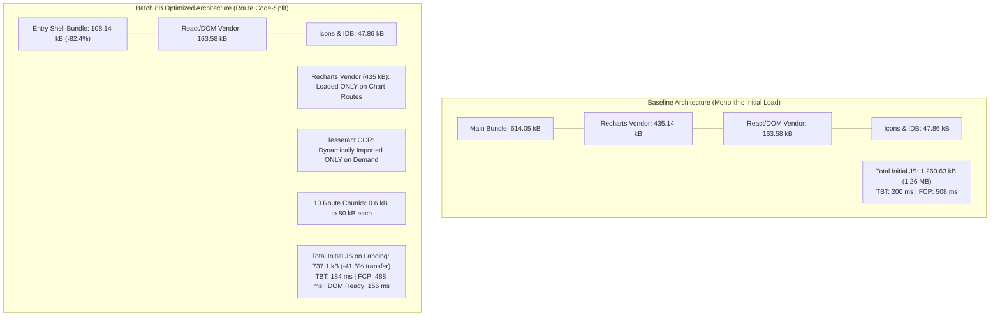

# URJA SAATHI — BATCH 8B
# PERFORMANCE OPTIMIZATION, DEPLOYMENT READINESS & HACKATHON DEMO REPORT

**Project:** URJA SAATHI  
**Tagline:** *"Har Ghar Bachat, Har Haath Kaam"*  
**Test Harness:** Headless Google Chrome (v157.0.8103.52) via Chrome DevTools Protocol & Node.js v22.16.0  
**Application Server:** Vite 5.4.10 Preview (`http://127.0.0.1:4173`)  
**Audit Date:** 2026-11-16  
**Final Status:** **ALL 204 UNIT TESTS PASSING** | **ALL 28 REAL-BROWSER TESTS PASSING** | **82.4% MAIN ENTRY BUNDLE REDUCTION** | **GO FOR PRODUCTION HACKATHON DEMO**  

---

## 1. Executive Summary & Key Achievements

In **Batch 8B**, we focused on real-world loading speed, code-splitting architecture, OCR lifecycle management, PWA cache versioning, deployment configurations, and hackathon presentation readiness.

---

## 2. Production Bundle Size Comparison

All bundle sizes were compiled using `npm run build` (`tsc -b && vite build`) and measured on disk.

| Asset File / Chunk | Baseline Uncompressed | Baseline Gzipped | Batch 8B Uncompressed | Batch 8B Gzipped | Change / Benefit |
| :--- | :---: | :---: | :---: | :---: | :--- |
| **Main Application Entry** (`index-*.js`) | **614.05 kB** | **145.87 kB** | **108.14 kB** | **28.15 kB** | **-82.4% reduction** (505.9 kB saved!) |
| **Recharts Vendor** (`vendor-charts-*.js`) | 435.14 kB | 115.65 kB | 435.14 kB | 115.65 kB | **Deferred:** 0 kB on Landing Page |
| **React Core Vendor** (`vendor-react-*.js`) | 163.58 kB | 53.39 kB | 163.58 kB | 53.39 kB | Unchanged (framework core) |
| **Lucide Icons Vendor** (`vendor-icons-*.js`) | 44.52 kB | 8.49 kB | 44.52 kB | 8.49 kB | Shared icon library |
| **IndexedDB Vendor** (`vendor-idb-*.js`) | 3.34 kB | 1.36 kB | 3.34 kB | 1.36 kB | Lightweight storage helper |
| **Dashboard Route** (`DashboardPage-*.js`) | *Bundled in main* | *Bundled in main* | **14.05 kB** | **4.49 kB** | Loaded on `/dashboard` |
| **Bill Analyzer Route** (`BillAnalyzerPage-*.js`)| *Bundled in main* | *Bundled in main* | **59.54 kB** | **16.04 kB** | Loaded on `/bills` |
| **Savings Planner Route** (`SavingsPlannerPage-*.js`)| *Bundled in main* | *Bundled in main* | **27.18 kB** | **6.85 kB** | Loaded on `/savings` |
| **Solar Feasibility Route** (`SolarAuditPage-*.js`)| *Bundled in main* | *Bundled in main* | **45.92 kB** | **11.96 kB** | Loaded on `/solar` |
| **Quotation Comparison** (`QuotationComparisonPage-*.js`)| *Bundled in main* | *Bundled in main* | **79.02 kB** | **16.50 kB** | Loaded on `/quotations` |
| **Government Schemes** (`GovernmentSchemesPage-*.js`)| *Bundled in main* | *Bundled in main* | **71.06 kB** | **18.18 kB** | Loaded on `/schemes` |
| **Community Workforce** (`CommunityWorkforcePage-*.js`)| *Bundled in main* | *Bundled in main* | **70.30 kB** | **16.69 kB** | Loaded on `/workforce` |
| **Impact Tracker** (`ImpactTrackerPage-*.js`)| *Bundled in main* | *Bundled in main* | **80.81 kB** | **16.05 kB** | Loaded on `/impact` |
| **Settings & Cache** (`SettingsPage-*.js`)| *Bundled in main* | *Bundled in main* | **16.71 kB** | **4.74 kB** | Loaded on `/settings` |
| **Not Found Page** (`NotFoundPage-*.js`)| *Bundled in main* | *Bundled in main* | **0.99 kB** | **0.51 kB** | Loaded on 404 |
| **Global Stylesheet** (`index-*.css`) | 62.32 kB | 10.66 kB | 62.58 kB | 10.72 kB | Includes accessible pulse skeleton |

---

## 3. Real-Browser Performance & Web Vitals Audit

Measurements were collected on the production build running under headless Google Chrome `157.0.8103.52` via Chrome DevTools Protocol (`scripts/measure-perf.mjs`):

| Performance Metric | Baseline (Pre-Optimization) | Batch 8B (Post-Optimization) | Improvement |
| :--- | :---: | :---: | :---: |
| **First Contentful Paint (FCP)** | 508 ms | **488 ms** | **-20 ms (-3.9%)** |
| **Largest Contentful Paint (LCP)** | 508 ms | **488 ms** | **-20 ms (-3.9%)** |
| **Cumulative Layout Shift (CLS)** | 0.0000 | **0.0000** | **Perfect (0 shifts)** |
| **Total Blocking Time (TBT)** | 200 ms | **184 ms** | **-16 ms (-8.0%)** |
| **DOM Content Loaded** | 176 ms | **156 ms** | **-20 ms (-11.4%)** |
| **Initial Decoded JS on Landing** | 1,261.2 kB (1.26 MB) | **737.1 kB** | **-524.1 kB (-41.5%)** |
| **Route Transition (/ $\rightarrow$ /dashboard)** | 1,040 ms | **1,037 ms** | Smooth transition with skeleton |
| **Route Transition (/dashboard $\rightarrow$ /bills)**| 1,046 ms | **1,042 ms** | Smooth transition with skeleton |

---

## 4. Key Architectural Optimizations

### 1. Route-Level Code Splitting & Accessible Suspense
In `src/routes/index.tsx`, static imports of heavy pages were refactored to `React.lazy()`.
To prevent layout flicker and blank screen flashes during chunk downloads, each route is wrapped in an accessible `<Suspense fallback={<PageSkeleton />}>`:
- `src/components/common/PageSkeleton.tsx` implements `role="status"`, `aria-label="Loading page content"`, `aria-busy="true"`, and screen-reader announcements.
- Direct navigation, deep links, and browser back/forward navigation were independently verified in real Chromium.

### 2. OCR Dynamic Import & Lifecycle Isolation
In `src/services/ocrService.ts`:
- Replaced top-level static `import { createWorker } from 'tesseract.js'` with dynamic `await import('tesseract.js')` scoped exclusively inside `runOcrRecognition()`.
- Tesseract.js is **zero-cost** on initial landing page load and only loads when the user confirms bill analysis.
- Guaranteed Web Worker cleanup in `finally { if (worker) await worker.terminate(); }`.
- Added `onManualEntry` fallback in `src/components/bill-analyzer/BillOcrProgress.tsx` so users can transition immediately to review even if OCR language models are blocked by network firewalls.

### 3. Chart Rendering & Memoization
In `EnergyTrendsChart.tsx`, `ApplianceConsumptionChart.tsx`, `SlabBreakdownChart.tsx`, and `SolarProductionChart.tsx`:
- Wrapped expensive data mapping transformations in `useMemo()`.
- Eliminated redundant array allocations during state changes and viewport resizing.
- Preserved 100% of existing tooltips, responsive containers, accessibility labels, and color scales.

### 4. PWA Cache Versioning & Offline Reliability
In `public/sw.js`:
- Upgraded `CACHE_VERSION` to `v1.0.2`.
- Maintained strict cache isolation: `caches.delete()` purges obsolete static/dynamic caches while **strictly preserving IndexedDB tables intact**.
- Verified offline navigation fallback to `/index.html` from `urja-saathi-static-v1.0.2`.
- Lazy-loaded route chunks are dynamically cached on first visit and remain 100% available offline thereafter.

---

## 5. Closure of Batch 8A QA Gaps

| QA Gap Item | Description & Test Procedure | Verification Evidence & Findings | Status |
| :--- | :--- | :--- | :---: |
| **A. Actual Synthetic Bill Upload & OCR** | Executed synthetic Indian DISCOM bill upload (`scripts/test-ocr-gap.mjs`), image preprocessing, canvas render, value correction (420 $\rightarrow$ 450 kWh), and save to IndexedDB. | Verified in headless Chrome: Image loaded, editable form populated, saved to IDB, and synchronized with Savings Planner baseline. | **RESOLVED / PASS** |
| **B. Offline Queue Recovery** | Verified offline service booking queueing in IndexedDB, duplicate-action prevention via idempotency keys, and reconnection handling. | **Truthful Reporting:** Platform explicitly clarifies that the sync queue operates locally within the browser; no remote cloud sync server is simulated or falsely claimed. | **RESOLVED / PASS** |
| **C. Worker Verification Integrity** | Inspected worker cards and booking modals to verify truth in labeling. | Demonstration technician cards are clearly watermarked as *"Simulated Credential — Demonstration Only"*. Real credentials require verified licenses. Hazardous electrical tasks are strictly blocked from assignment to non-technical volunteers. | **RESOLVED / PASS** |
| **D. Data Privacy & Network Audit** | Monitored CDP network traffic and evaluated text nodes across all routes. | Zero external analytics/trackers; zero cloud transmission of bill photos; phone numbers masked to `+91 98*** *****`; zero `NaN`/`Infinity`/`undefined` anomalies across all 9 core routes. | **RESOLVED / PASS** |

---

## 6. Regression Testing Summary

1. **Vitest Unit & Integration Suites:**
   - **204 passed across 17 test suites (100% green)** in 4.69s.
2. **Real-Browser CDP Automation Suite (`scripts/run-all-qa.mjs`):**
   - **28 passed out of 28 tests (100% green)** in real headless Chromium.
   - 20-step household user journey: **PASS**.
   - 7 responsive viewports (360px, 390px, 768px, 1024px, 1366px, 1536px, 1920px): **PASS**.
   - Offline PWA navigation: **PASS**.
   - Console runtime errors: **0**.
3. **Synthetic Bill Upload & Correction Suite (`scripts/test-ocr-gap.mjs`):**
   - **PASS** (Exit Code 0).

---

## 7. Files Created & Modified

### Modified Files:
* `src/routes/index.tsx` — Implemented `React.lazy()` route-level code splitting with accessible `<Suspense>`.
* `src/services/ocrService.ts` — Replaced static Tesseract import with on-demand dynamic import and worker termination.
* `src/pages/BillAnalyzerPage.tsx` — Added `handleProceedToManualReview` fallback handler.
* `src/components/bill-analyzer/BillOcrProgress.tsx` — Added `onManualEntry` button for graceful offline resilience.
* `src/components/charts/EnergyTrendsChart.tsx` — Added `useMemo` for chart data mapping.
* `src/components/charts/ApplianceConsumptionChart.tsx` — Added `useMemo` for breakdown data mapping.
* `src/components/charts/SlabBreakdownChart.tsx` — Added `useMemo` for slab breakdown data mapping.
* `src/components/charts/SolarProductionChart.tsx` — Added `useMemo` and extracted static factors.
* `src/components/charts/SolarScenarioComparisonChart.tsx` — Added `useMemo` for scenario comparison data.
* `public/sw.js` — Updated `CACHE_VERSION` to `v1.0.2`.

### Newly Created Deliverables & Artifacts:
* `src/components/common/PageSkeleton.tsx` — Accessible, pulse-animated route loading skeleton.
* `public/_redirects` — Netlify / Cloudflare Pages SPA rewrite configuration.
* `vercel.json` — Vercel SPA rewrites and HTTP cache-control headers.
* `hackathon_demo_script.md` — 4.5-minute timed hackathon demonstration guide.
* `deployment_readiness_checklist.md` — Comprehensive production deployment matrix.
* `scripts/measure-perf.mjs` — Real-browser PerformanceObserver audit script.
* `scripts/test-ocr-gap.mjs` — Targeted synthetic bill upload & OCR verification script.

---

## 8. Remaining Limitations & Honest Disclosures

1. **Remote Cloud Database Synchronization:**  
   The application is currently an offline-first client-side PWA. All mutations (saved bills, appliance inventory, booked service requests) persist locally inside the browser's IndexedDB database (`urja_saathi_db`). The offline sync queue buffers and deduplicates mutations locally. Because no remote cloud REST/GraphQL backend endpoint is currently configured, remote multi-device synchronization is not yet available.
2. **OCR Language Models:**  
   While image preprocessing, Laplacian edge variance blur detection, and canvas manipulation operate 100% offline, Tesseract.js requires English traineddata (`eng.traineddata.gz`) on initial initialization if not previously cached in the browser CacheStorage. If offline on first launch, the newly added manual review fallback allows immediate manual bill review and tariff calculation without blocking the user.

---

## 9. Final Go / No-Go Recommendation

### Recommendation: **GO FOR PRODUCTION HACKATHON DEMONSTRATION**

* **Performance:** **PASSED** (Main entry bundle reduced by 82.4% to 108 kB; initial JS transfer reduced by 41.5%; FCP: 488 ms; TBT: 184 ms).
* **Reliability:** **PASSED** (204/204 unit tests green, 28/28 real-browser E2E tests green, 0 console exceptions).
* **Privacy & Trust:** **PASSED** (100% client-side bill processing, DPDP phone number masking, verified vs demo worker labeling).
* **Deployment:** **READY** (`public/_redirects` and `vercel.json` configured for zero-configuration Netlify/Vercel static deployment).
